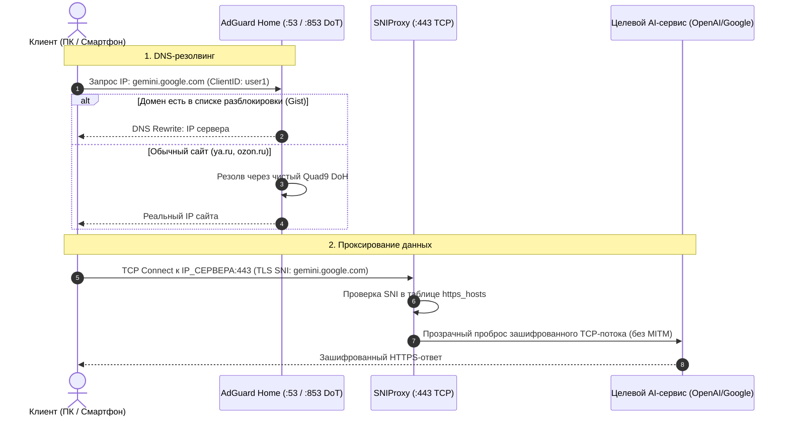

# smart-dns-server

Серверная часть персонального **Smart DNS** (AdGuard Home + SNIProxy) для выборочной разблокировки AI-сервисов (ChatGPT, Claude, Gemini, Google AI Studio, OpenRouter, Spotify) **без использования VPN, TUN-адаптеров и расшифровки TLS**.

Обычный интернет (Яндекс, Озон, банки, локальный трафик) идёт напрямую на полной скорости провайдера, а запросы к заблокированным сервисам прозрачно проксируются через зарубежный VPS.

Клиентская часть для компьютеров Windows: [acrylic-dns-unlock](https://github.com/fdoo24/acrylic-dns-unlock).

---

## 🏗 Архитектура и принцип работы



* **SNIProxy (порт 443):** Принимает HTTPS-пакеты, считывает имя запрашиваемого домена из заголовка `TLS ClientHello` (SNI) и пробрасывает поток напрямую к реальным серверам. Не требует чужих сертификатов и не вмешивается в шифрование.
* **AdGuard Home (порты 53, 853, 3000):** Отвечает на DNS-запросы. Перенаправляет список AI-доменов на локальный SNIProxy, а всё остальное резолвит напрямую через Quad9 DoH.
* **Скрипт `sync_gist.sh`:** Ежечасно по cron скачивает актуальный `domains.txt` из GitHub Gist, обновляет конфиг `sniproxy.conf` и при необходимости перезапускает контейнер.

---

## ⚡ Быстрый старт (Установка за 3 минуты)

### Требования
* Сервер с ОС **Ubuntu 22.04 / 24.04** или **Debian 11/12**.
* Зарегистрированный бесплатный домен на [duckdns.org](https://www.duckdns.org) (например, `mysmartdns.duckdns.org`) и ваш **DuckDNS Token**.
* Свободные порты `53` (TCP/UDP), `853` (TCP/UDP), `443` (TCP) и `3000` (TCP).

### 1. Клонирование и запуск установщика

Подключитесь к вашему VPS по SSH и выполните:

```bash
git clone https://github.com/fdoo24/smart-dns-server.git
cd smart-dns-server
sudo bash scripts/install.sh
```

Установщик:
1. Автоматически установит Docker и необходимые системные утилиты.
2. Запросит ваш домен DuckDNS и токен.
3. Выпустит бесплатный **Wildcard SSL-сертификат** (`*.домен` + `домен`) через `acme.sh`.
4. Синхронизирует список доменов из Gist.
5. Настроит системный `cron` на ежечасное автообновление.
6. Запустит контейнеры в Docker Compose.

---

## 🔑 Токен DuckDNS и Wildcard-сертификаты

> [!TIP]
> **Один токен на всё:** В DuckDNS один Token управляет всей вашей учетной записью.  
> Благодаря поддержке **Wildcard DNS**, любой поддомен (например, `user1.mysmartdns.duckdns.org`) **автоматически** указывает на ваш сервер — создавать поддомены на сайте DuckDNS вручную **не требуется**.

Сертификат выпускается сразу на основной домен и все поддомены:
```bash
~/.acme.sh/acme.sh --issue --dns dns_duckdns \
  -d mysmartdns.duckdns.org \
  -d *.mysmartdns.duckdns.org
```
Он сохраняется в папку `./ssl/` и монтируется в AdGuard Home для работы защищённого DoT/DoQ.

---

## ⚙️ Первичная настройка AdGuard Home

После завершения работы `install.sh`:

1. Откройте веб-панель в браузере: `http://IP_СЕРВЕРА:3000`.
2. Завершите начальный мастер (придумайте логин и пароль администратора).
3. Перейдите в **«Настройки» → «Настройки шифрования»** (Encryption settings):
   * Поставьте галочку **«Включить шифрование»**.
   * В поле **«Имя сервера»** введите ваш домен: `mysmartdns.duckdns.org`.
   * **Путь к цепочке сертификатов:** `/opt/adguardhome/ssl/fullchain.pem`.
   * **Путь к приватному ключу:** `/opt/adguardhome/ssl/privkey.pem`.
   * Нажмите **«Сохранить конфигурацию»**.
4. Перейдите в **«Фильтры» → «Блокировки DNS» → «Добавить черный список»**:
   * Имя: `Smart DNS Rules`.
   * URL: `https://gist.githubusercontent.com/fd25-cyber/06084693e9c14ed6accc0c8e165c2fbf/raw/domains.txt`
   * Нажмите **«Сохранить»**.

---

## 👥 Добавление пользователей и подключение устройств

Разделение пользователей и персональная статистика настраиваются через **Client ID**:

### 1. Создание клиента в AdGuard Home
1. Откройте **«Настройки» → «Клиенты»** → кнопка **«Добавить клиента»**.
2. **Имя:** например, `Misha Phone` или `Laptop Work`.
3. **Идентификаторы:** впишите уникальный ID, например: `misha-dev123`.
4. Сохраните.

### 2. Подключение на устройствах

* **Android (Персональный DNS):**
  Настройки телефона → *Сеть и интернет* → *Персональный DNS-сервер* → ввести:
  ```text
  misha-dev123.mysmartdns.duckdns.org
  ```
* **ПК на Windows:**
  Используйте клиент [acrylic-dns-unlock](https://github.com/fdoo24/acrylic-dns-unlock) либо укажите в DoT-клиенте адрес:
  ```text
  tls://misha-dev123.mysmartdns.duckdns.org:853
  ```
* **iOS / macOS:**
  Установите DNS-профиль (DoT или DoH) с адресом вашего сервера.

AdGuard Home автоматически определит клиента по префиксу поддомена и применит к нему персональные настройки.

---

## 📋 Полезные команды для диагностики

```bash
# Проверить статус контейнеров
docker compose ps

# Посмотреть логи SNIProxy
docker logs --tail 50 smart-dns-sniproxy

# Посмотреть логи AdGuard Home
docker logs --tail 50 smart-dns-adguard

# Принудительно запустить синхронизацию доменов из Gist
sudo bash scripts/sync_gist.sh

# Проверить резолвинг домена через локальный AdGuard Home
dig @127.0.0.1 gemini.google.com +short
dig @127.0.0.1 openrouter.ai +short

# Проверить работу SNI-проксирования локально на сервере
curl -sI --resolve openrouter.ai:443:127.0.0.1 https://openrouter.ai | head -n 5
```

---

## 📄 Лицензия

Проект распространяется под лицензией [MIT](LICENSE).
Компоненты:
* [AdGuard Home](https://github.com/AdguardTeam/AdGuardHome) — GPLv3
* [SNIProxy](https://github.com/dlundquist/sniproxy) — BSD-2-Clause
* [acme.sh](https://github.com/acmesh-official/acme.sh) — GPLv3
